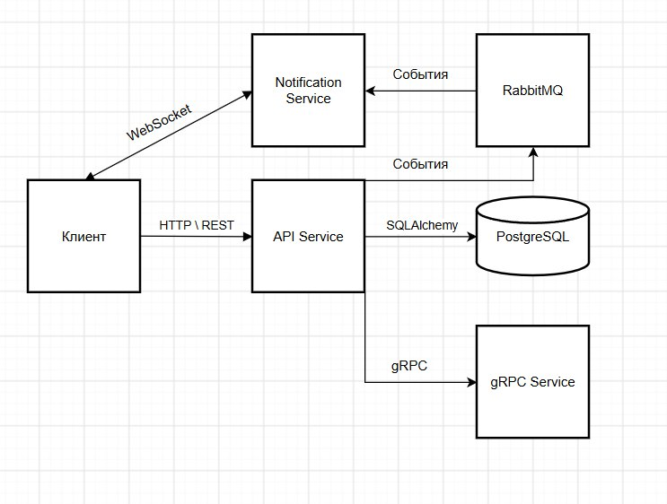
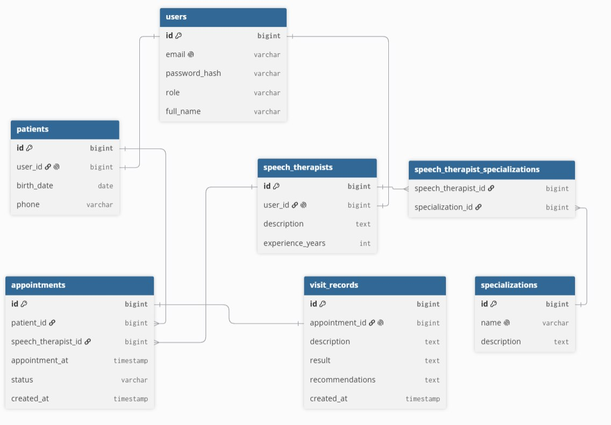

# Информационная система центра логопедии

Учебный проект по дисциплине **«Технологии сетевого программирования»**. В README описаны результаты лабораторных работ №0, №1 и №2: проектирование информационной системы, реализация работы с базой данных и разработка REST API.

## Назначение проекта

Информационная система предназначена для автоматизации работы центра логопедии: хранения данных о пациентах и специалистах, учёта специализаций, записи на приём и ведения истории посещений.

**Роли:**
- **Пациент:** регистрация, просмотр специалистов, запись на приём, просмотр своих записей и результатов посещений.
- **Логопед:** работа с расписанием, результатами занятий и рекомендациями.
- **Администратор:** управление пользователями, логопедами и справочными данными в пределах предоставленных прав.

## Технологии

| Технология | Назначение |
| --- | --- |
| Python | Язык программирования |
| PostgreSQL | Реляционная база данных |
| SQLAlchemy | ORM и работа с БД |
| FastAPI | REST API |
| Pydantic | Валидация данных и DTO |
| Uvicorn | ASGI-сервер |
| Nginx | Обратный прокси-сервер |
| JWT (HS256) | Аутентификация пользователей |
| Argon2 | Хеширование паролей |
| Postman | Проверка HTTP-запросов |

---

## Лабораторная работа №0 — Проектирование информационной системы

**Тема:** выбор и описание предметной области, проектирование функционала приложения.

**Цель:** сформулировать техническое задание и определить структуру информационной системы.

### Выполненные задачи

1. Выбрана предметная область — **центр логопедии**.
2. Сформулирована бизнес-цель: упростить запись пациентов на приём и централизовать хранение истории посещений.
3. Определены роли пользователей и их возможности.
4. Описаны сценарии регистрации, авторизации, просмотра специалистов, записи на приём и работы с результатами посещений.
5. Спроектированы архитектура приложения, логическая и физическая схемы базы данных.

### Диаграммы из ЛР0

**Архитектура приложения**



**ER-диаграмма базы данных**



Для отображения на GitHub изображения должны находиться в папке `images` рядом с `README.md`.

### Основные сущности

| Сущность | Назначение |
| --- | --- |
| `User` | Учётные записи и роли |
| `Patient` | Профили пациентов |
| `SpeechTherapist` | Профили логопедов |
| `Specialization` | Специализации логопедов |
| `Appointment` | Записи на приём |
| `VisitRecord` | Результаты посещений и рекомендации |

Связь **многие-ко-многим** между `SpeechTherapist` и `Specialization` реализуется через промежуточную таблицу `speech_therapist_specializations`.

Основные связи:
- `User` связан с профилем пациента или логопеда.
- `Appointment` ссылается на пациента и логопеда.
- `VisitRecord` ссылается на проведённый приём.

Для предотвращения двойной записи к одному логопеду на одно время в проектной схеме предусмотрена уникальность пары `(speech_therapist_id, appointment_at)`.

**Результат ЛР0:** описание предметной области, функциональных сценариев, архитектуры и схемы БД.

---

## Лабораторная работа №1 — PostgreSQL и SQLAlchemy

**Тема:** проектирование базы данных и реализация слоя доступа к данным.

**Цель:** изучить принципы хранения данных и использование ORM.

### Реализация

- Создана база данных PostgreSQL `speech_center`.
- Реализованы ORM-модели на SQLAlchemy в соответствии со схемой ЛР0.
- Настроены подключение к БД и управление сессиями.
- Реализованы операции создания, чтения, изменения и удаления (CRUD) основных сущностей.
- Предусмотрена работа со связями между пользователями, пациентами, логопедами, специализациями, записями на приём и результатами посещений.
- Слой доступа к данным используется в последующей ЛР2.

### Примеры операций

1. Создать пользователя и профиль пациента.
2. Получить список логопедов и специализаций.
3. Создать запись на приём.
4. Изменить дату, время или статус записи.
5. Сохранить результат посещения и рекомендации.
6. Получить историю посещений пациента.

**Результат ЛР1:** слой работы с PostgreSQL на SQLAlchemy, используемый REST API.

---

## Лабораторная работа №2 — REST API

**Тема:** разработка REST API.

**Цель:** организовать взаимодействие с системой через HTTP-запросы.

### Архитектура

```text
Postman / HTTP-клиент
        |
        | HTTP + JSON
        v
    Nginx :8080
        |
        | proxy_pass
        v
   Uvicorn :8000
        |
        v
      FastAPI
        |
        | Pydantic, Depends, JWT, проверка ролей
        v
     SQLAlchemy
        |
        v
PostgreSQL (speech_center)
```

Nginx выступает обратным прокси и направляет запросы на Uvicorn. FastAPI проверяет данные, аутентификацию и права доступа, затем обращается к PostgreSQL через SQLAlchemy и возвращает JSON.

### Аутентификация и авторизация

1. `POST /api/auth/register` — регистрация пользователя.
2. `POST /api/auth/login` — проверка email и пароля.
3. Пароли хранятся в виде хешей с использованием **Argon2**.
4. После входа сервер выдаёт **JWT Access Token**, подписанный **HS256**.
5. Клиент передаёт его в заголовке `Authorization: Bearer <token>`.
6. FastAPI извлекает и проверяет токен, определяет пользователя и проверяет права доступа.

**Access Token действует 60 минут. Refresh Token в текущей реализации не используется.**

Для управления сессиями БД применяется внедрение зависимостей `Depends(get_db)` с `yield`, позволяющее закрывать сессию после обработки запроса.

### Основные маршруты

Все маршруты имеют префикс `/api`.

| Метод | Маршрут | Назначение |
| --- | --- | --- |
| `GET` | `/api/health` | Проверка работоспособности |
| `POST` | `/api/auth/register` | Регистрация |
| `POST` | `/api/auth/login` | Авторизация и выдача JWT |
| `GET`, `PATCH` | `/api/users/me` | Свой профиль |
| `GET` | `/api/users` | Список пользователей |
| `GET`, `DELETE` | `/api/users/{user_id}` | Пользователь по ID |
| `GET`, `PATCH` | `/api/patients/me` | Профиль пациента |
| `GET` | `/api/patients` | Список пациентов |
| `GET` | `/api/patients/{patient_id}` | Пациент по ID |
| `POST`, `GET` | `/api/therapists` | Создание / список логопедов |
| `GET`, `PATCH`, `DELETE` | `/api/therapists/{therapist_id}` | Операции с логопедом |
| `POST`, `GET` | `/api/specializations` | Создание / список специализаций |
| `GET`, `PATCH`, `DELETE` | `/api/specializations/{spec_id}` | Операции со специализацией |
| `POST`, `GET` | `/api/appointments` | Создание / список записей |
| `GET`, `PATCH`, `DELETE` | `/api/appointments/{appointment_id}` | Операции с записью |
| `POST`, `GET` | `/api/visit-records` | Создание / список результатов |
| `GET`, `PATCH`, `DELETE` | `/api/visit-records/{record_id}` | Операции с результатом |

Доступ к отдельным операциям ограничен ролями и проверками принадлежности данных.

### Пример создания записи на приём

```http
POST /api/appointments
Authorization: Bearer <JWT>
Content-Type: application/json
```

```json
{
  "speech_therapist_id": 1,
  "appointment_at": "2026-11-05T14:00:00"
}
```

Пациент определяется по JWT. `speech_therapist_id` — ID профиля логопеда, а не ID его учётной записи `User`.

### Проверка через Postman

После успешного входа Postman сохраняет токен в переменную коллекции `{{token}}` с помощью скрипта:

```javascript
if (pm.response.code === 200) {
    const data = pm.response.json();
    pm.collectionVariables.set("token", data.access_token);
}
```

В настройках авторизации используется тип **Bearer Token** со значением `{{token}}`.

Для проверки можно выполнить вход администратором, создать/изменить/удалить специализацию, войти пациентом, создать запись на приём и проверить ограничения доступа. В зависимости от операции API возвращает HTTP-коды `200`, `201`, `204`, `401`, `403`, `404`, `409` и другие.

**Результат ЛР2:** работающий REST API с JSON, Pydantic DTO, JWT, ролевой авторизацией и Nginx.

---

## Запуск проекта

Пример для **Windows PowerShell**. Перед запуском необходимо установить зависимости проекта, настроить PostgreSQL и переменные окружения, включая `JWT_SECRET_KEY`.

Из корневой папки проекта:

```powershell
python -m uvicorn app.main:app --host 127.0.0.1 --port 8000
```

Адреса для проверки:
- `http://localhost:8000/api/health` — проверка API;
- `http://localhost:8000/docs` — Swagger UI;
- `http://localhost:8080/api/health` — через Nginx, если прокси запущен и настроен.

**Безопасность:** реальные пароли базы данных и значение `JWT_SECRET_KEY` нельзя публиковать в репозитории.


